<p align="center">
  
</p>

<p align="center">
  <strong>Real-Time WebAI Speech-to-ASL Virtual Webcam for Accessible Video Calls</strong>
</p>

<p align="center">
  
</p>

---

<h1 align="center">🚧 WORK IN PROGRESS — INCOMPLETE PROTOTYPE 🚧</h1>

> [!WARNING]
> **OpenASL is actively under construction and is not yet feature-complete.**
> Speech recognition, ASL grammar translation, pose vocabulary coverage, and desktop packaging are still evolving. Expect rough edges, missing signs (which currently fall back to fingerspelling), and rapid changes as we build toward a full release with community contributors.

---

## About OpenASL

**OpenASL** is a free, open-source **real-time Speech-to-ASL Virtual Webcam** built to make everyday online conversations on **Zoom, Microsoft Teams, Google Meet, Discord, and browser video chats** more accessible for Deaf and Hard-of-Hearing people.

When you speak into your microphone, OpenASL translates spoken English into **American Sign Language (ASL) Time-Topic-Comment grammar** and composites a live animated ASL signer in the **bottom-right corner of your webcam feed**, outputting it directly as a system-level PC virtual webcam — **free, 100% on-device, and with zero AI-generated sign visuals.**

- **Authentic Human Motion (Zero AI-Generated Visuals):** Signs are driven by real Deaf-signer MediaPipe Holistic motion-capture landmarks rendered live at 30 FPS on HTML5 `<canvas>`, with public-domain A–Z fingerspelling fallback for proper nouns and uncommon words.
- **100% On-Device Privacy:** Audio transcription, grammar translation, and video compositing run directly on your machine inside the browser.
- **Plug-and-Play Virtual Camera:** Outputs directly to a lightweight system virtual camera driver (`UnityCapture` on Windows / `v4l2loopback` on Linux) ready for Zoom, Teams, Discord, and browser calls.

---

## 🤝 TBD — Roadmap (With Community Assistance)

OpenASL is built for the Deaf and Hard-of-Hearing community, and we want real signers, volunteer artists, and native speakers to help shape what comes next:

1. **Open-Source Sign-to-Voice Interpretation (Two-Way Communication)**
   Real-time **Sign Language → Spoken Voice** conversion so hearing users can understand Deaf signers just as easily as Deaf users can understand hearing speakers. True accessibility has to work in both directions — without two-way interpretation, the tool is only half complete.
2. **Community Hand-Drawn Sign Animations (Volunteer Artists Needed)**
   While we currently render real MediaPipe landmark rigs to avoid AI-generated visuals, our long-term goal is a warm, expressive **open directory of hand-drawn Sign Language GIFs and animations**. As an open-source, non-commercial project, we unfortunately cannot pay contributors — but if you'd like to donate your time and talent out of the kindness of your heart, **every contributing artist will be prominently credited in both the animation directory and this repository**.
3. **FinnSL & FinnSSL Support (Finland)**
   Dedicated lexicon, grammar rules, and native pose packs for **Finnish Sign Language (FinnSL / *Suomalainen viittomakieli*)** and **Finland-Swedish Sign Language (FinnSSL / *Finlandssvenskt teckenspråk*)** for Finnish users.
4. **Additional Sign Languages (Community-Requested)**
   Expanding OpenASL's modular gloss + pose-pack architecture to support **BSL, Auslan, LSF, DGS, ISL**, and any other regional or national sign languages requested and contributed by the community.
5. **Everyday Slang & Informal Expressions**
   Academic ASL datasets are almost exclusively formal textbook vocabulary — yet casual banter, idioms, and unfiltered everyday slang are a natural part of how friends actually talk. Deaf and Hard-of-Hearing signers deserve the same natural freedom of expression as hearing speakers, rather than being artificially restricted to formal language.

*Want to help record missing signs, donate hand-drawn animations, or bring your local sign language to OpenASL? Open an Issue or Pull Request!*

---

##  — How OpenASL Uses WebAI

Everything that powers the intelligence of OpenASL runs **directly inside the browser** using modern WebAI runtimes (WebGPU + WebAssembly) — no paid API keys, no remote inference servers:

| Stage | WebAI Technology | How It's Used |
| :--- | :--- | :--- |
| **Offline Speech-to-Text** | [`@huggingface/transformers`](https://huggingface.co/docs/transformers.js) (`Moonshine Tiny` & `Whisper Tiny.en`) | Runs inside a dedicated **Web Worker** on **WebGPU** (with automatic **WASM** fallback) with an adaptive-noise-floor VAD that streams live speech bursts in real time. |
| **Instant Streaming STT** | Browser **Web Speech API** | Zero-download streaming option with mid-sentence word committing and automatic crash/reconnect recovery. |
| **ASL Grammar Translation** | [`compromise`](https://github.com/spencermountain/compromise) + [`@mlc-ai/web-llm`](https://github.com/mlc-ai/web-llm) | Instant (~2 ms) Time-Topic-Comment gloss engine in JS, plus an optional **local WebGPU LLM** (`SmolLM2-360M` / `Llama-3.2-1B`) running 100% client-side. |
| **Live Pose & Webcam Compositing** | **HTML5 `<canvas>`** (30 FPS) + Background Web Worker Timer | Renders **257 real adult WLASL MediaPipe Holistic pose sequences** with smooth cubic-eased joint interpolation, A–Z fingerspelling with double-letter bounce, and live mirrored webcam PiP compositing. |

---

## Quickstart

### Option 1: One-Click Windows Launcher (Temporary Dev Binary)

Double-click **`OpenASL-Start.exe`** in the repo folder (built from [`launcher/main.go`](launcher/main.go)). It automatically:
1. Runs `npm install` (if needed).
2. Creates an isolated `bridge/.venv` and installs virtual camera dependencies (`pyvirtualcam`, `websockets`, `opencv-python-headless`, `numpy`).
3. Prompts once to register the `UnityCaptureFilter64.dll` virtual webcam driver.
4. Starts both the Virtual Camera Bridge and the WebAI frontend, and opens `http://localhost:5173` automatically.

### Option 2: Manual Setup (Dev)

```bash
# 1. Start the WebAI Frontend
npm install
npm run dev
```

**Enable System-Level Virtual Webcam:**
- **Windows (one-time, Administrator PowerShell):**
  ```powershell
  powershell -ExecutionPolicy Bypass -File bridge\install_windows_vcam.ps1
  ```
- **Linux:**
  ```bash
  bash bridge/setup_linux_vcam.sh
  ```

**Start the Virtual Camera Bridge:**
```bash
pip install -r bridge/requirements.txt
python3 bridge/virtualcam_bridge.py
```

Click **Start Mic**, **Enable Webcam PiP**, and **Stream Virtual Cam** in OpenASL, then select **Unity Video Capture** (Windows) or **OpenASL Camera** (Linux) inside Zoom, Teams, Discord, or your browser.

---

## Expanding Vocabulary (~2,000 Adult Signs)

```bash
# Default 257-sign core conversational pack (already bundled):
npm run fetch:poses

# Full ~2,000-sign WLASL pose pack from HuggingFace:
uv run --with pyarrow --with numpy python3 scripts/fetch_wlasl_poses.py --all
```

### Dataset Attribution
- **Adult Word Pose Landmarks:** Derived from **WLASL** via [`Kibalama/poseformer-sign-language`](https://huggingface.co/datasets/Kibalama/poseformer-sign-language) (Computational Use of Data Agreement, C-UDA — academic / non-commercial computational use).
- **Manual Alphabet (A–Z):** Public-domain SVG illustrations sourced from Wikimedia Commons (`Category:ASL_letters`).